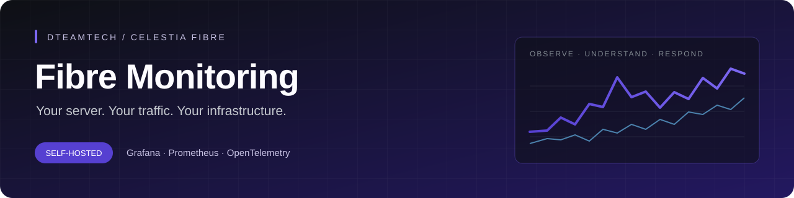
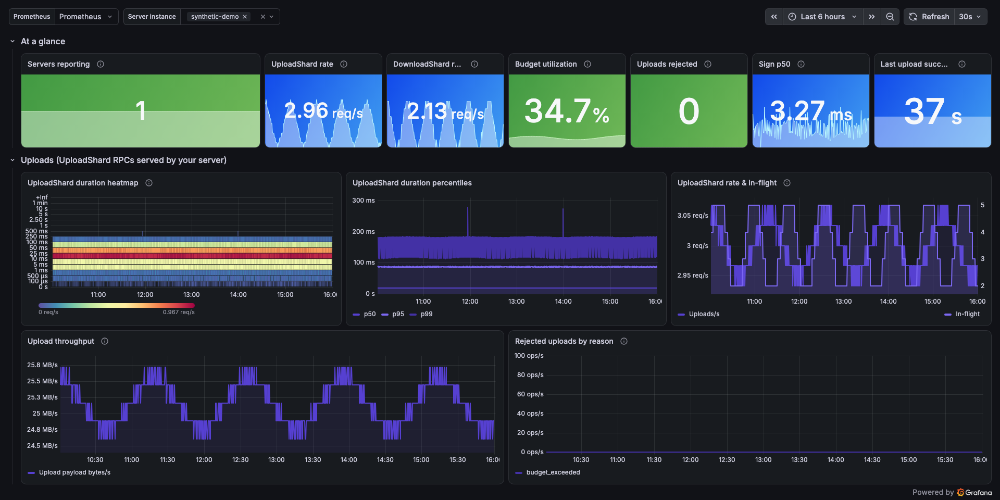

<p align="center">
  
</p>

# Celestia Fibre Monitoring

**Your Fibre server, traffic and storage in one local Grafana dashboard.**

A self-hosted monitoring bundle by **DTEAMTECH**. Run it with Docker Compose, connect your existing Fibre service and explore its telemetry. Enable alerts when you want them; choose where notifications go.

[Quick start](#quick-start) · [Dashboard](#dashboard) · [Optional alerts](#optional-alerts) · [Configuration](#configuration) · [Troubleshooting](#troubleshooting) · [Roadmap](#roadmap)

---

## Key features

| | What you can see |
|---|---|
| **Traffic** | Upload/download throughput, payload volume, request counts and latency percentiles |
| **Storage** | Occupancy versus budget, rejected uploads, backend errors and prune cycles |
| **Signing** | Payment-promise signing attempts, duration and failures |
| **Runtime** | Go memory and goroutines, alongside server telemetry presence |
| **Optional alerts** | Budget pressure, request failures, signing/storage errors and missing telemetry |
| **Local control** | Persistent storage, provisioned dashboards, pinned images and private service ports |

> [!NOTE]
> **Current coverage: internal Fibre telemetry.** The goal is full self-hosted Fibre exploration, including outside-view latency, endorsements and network blob activity. The separate [FibreStats explorer](https://github.com/zeroiwobro/fibrestats) already provides probes and chain ingestion; its Grafana integration and provider endorsement attribution are next. Run it on infrastructure you control. No external data feed is configured here yet.

## Quick start

### 1. Start the stack

You need Docker with the Compose plugin and a running Fibre server. These instructions assume Fibre runs directly on the same host as Docker. The metric contract is based on celestia-app **v10.4.0**; other releases need verification.

Clone the repository and enter the monitoring directory:

```bash
git clone https://github.com/DTEAMTECH/fibre-monitoring.git
cd fibre-monitoring/monitoring
docker compose up -d
```

Open **http://localhost:3000**. Sign in with `admin` / `admin` and change the password when prompted. The **Fibre Server — Operator** dashboard and **Prometheus** data source are already installed.

For a password of your choice before the first start, create `.env` in the current directory (`fibre-monitoring/monitoring/`):

```dotenv
GRAFANA_ADMIN_PASSWORD=your-long-password
```

Then start the stack. `.env` is ignored by Git. The password setting only initializes a new Grafana database; changing it later does not reset an existing account.

| Service | Local address | Purpose |
|---|---|---|
| Grafana | http://localhost:3000 | Dashboard |
| Prometheus | http://localhost:9091 | Queries, scrape status and optional alert rules |
| OTLP receiver | http://127.0.0.1:4318 | Fibre pushes telemetry here |
| Alertmanager, if enabled | http://localhost:9093 | Alert groups and silences |

Ports bind to `127.0.0.1`. The collector's metrics endpoint is available only inside the Compose network. Prometheus uses host port **9091** to avoid the application gRPC service commonly running on **9090** on Celestia validator hosts.

If this is a remote server, use an SSH tunnel from your laptop:

```bash
ssh -L 3000:127.0.0.1:3000 user@your-server
```

Then open http://localhost:3000 on your laptop.

### 2. Connect your existing Fibre service

Fibre has no Prometheus scrape endpoint. It pushes OTLP/HTTP to a collector. Add this flag to your existing start command, keeping your current home, node and signer configuration:

```bash
--otel-endpoint http://127.0.0.1:4318
```

Alternatively, set the environment variable used by your service:

```dotenv
FIBRE_OTEL_ENDPOINT=http://127.0.0.1:4318
```

For a systemd service named `fibre`, open an override:

```bash
sudo systemctl edit fibre
```

Add:

```ini
[Service]
Environment="FIBRE_OTEL_ENDPOINT=http://127.0.0.1:4318"
```

If the existing command already has `--otel-endpoint`, update that flag too. Apply the change during your normal maintenance window:

```bash
sudo systemctl daemon-reload
sudo systemctl restart fibre
```

Use the **base URL**, without `/v1/metrics`. Fibre appends its metrics and traces paths. This stack accepts traces and discards them; no trace database is needed.

Fibre normally exports every 60 seconds. Allow about two minutes for the first readings. Occupancy and budget should appear even on an idle server; request latency and byte counters need actual traffic.

**If Fibre is in a container:** `127.0.0.1` is that container, not the host. Connect it to the monitoring network and use `http://collector:4318`, or supply another private route. If Fibre runs on another machine, use a private network or tunnel and bind the collector to the required private interface; the default loopback mapping deliberately accepts only local traffic. No receiver authentication is configured.

### 3. Check that data arrives

```bash
docker compose ps
docker compose logs --tail 50 collector
```

Open http://localhost:9091/targets. The `fibre` job should be **UP**. This proves that Prometheus can scrape the collector; it does not by itself prove Fibre is sending data.

Run this query in Prometheus to check the server stream:

```promql
fibre_server_upload_shard_occupancy_bytes
```

Or query from the terminal:

```bash
curl --get http://127.0.0.1:9091/api/v1/query \
  --data-urlencode 'query=fibre_server_upload_shard_occupancy_bytes'
```

In Grafana, select your server in **Server instance**. The identity comes from Fibre's hostname (`service.instance.id`), so use unique hostnames if you send multiple servers into one collector.

An idle network is healthy. Empty request panels before the first request are expected. The collector removes cached series after two minutes without fresh telemetry; the availability alert adds another five-minute grace period. One missed export may therefore be tolerated, and detection is not immediate.

## Dashboard



*Actual Grafana UI with synthetic demonstration data. No live validator readings are shown.*

### Read the traffic panels correctly

- **Upload/download throughput:** shard-row payload bytes per second handled by this server.
- **Payload volume:** estimated counter increase across the selected time range.
- **Completed RPCs:** upload/download attempts, including failures; these are not unique blob counts.
- **Latency percentiles:** server handler timing, not internet ping or end-to-end client latency.
- **In-flight RPCs:** concurrent operations, not total network connections or configured connection capacity.

Successful duplicate uploads count again in upload bytes. Download bytes are recorded before returning the response and do not prove full client receipt. Neither counter includes transport overhead or measures interface bandwidth. Network-wide blob volume will come through the planned FibreStats integration; host bandwidth needs host metrics.

Storage occupancy includes limiter reservations. It is separate from physical disk usage. Signing latency measures Fibre payment-promise signing/waiting and has no universal 10 ms threshold. [Exact-tag instruments](https://github.com/celestiaorg/celestia-app/blob/v10.4.0/fibre/server_metrics.go), [upload byte accounting](https://github.com/celestiaorg/celestia-app/blob/v10.4.0/fibre/server_upload.go), [download byte accounting](https://github.com/celestiaorg/celestia-app/blob/v10.4.0/fibre/server_download.go).

## Optional alerts

The normal stack evaluates **no alert rules**. To enable the rule pack and local Alertmanager:

```bash
docker compose -f compose.yaml -f compose.alerts.yaml up -d
```

Alerts are visible at http://localhost:9091/alerts and http://localhost:9093. **No notifications are sent until you configure a receiver.**

| Check | Default trigger |
|---|---|
| Collector scrape | Down for 2 minutes |
| Fibre telemetry | All server occupancy gauges absent for 5 minutes, after cache expiration |
| Storage budget | Above 80% for 15 minutes; above 95% for 5 minutes |
| Budget rejections | Any increase in the last 15 minutes |
| Upload/download failures | More than 10% of at least 20 completed RPCs in 15 minutes, sustained for 5 minutes |
| Signing, pruning or backend errors | At least 3 errors in 15 minutes |
| Uploads without recent success | Successful uploads stale while that same server continues completing upload attempts |

These thresholds are starting points. Adjust [`monitoring/prometheus/fibre_alerts.yml`](monitoring/prometheus/fibre_alerts.yml) to your workload. No uploads, zero prune deletions, or a missing settlement endorsement alone are not failures.

The current missing-telemetry rule is a whole-stack check. With several servers, it does not detect one disappearing while another keeps reporting; that requires an explicit expected-server inventory.

### Optional notifications

Alertmanager supports Telegram, Discord, webhooks and other receivers. Keep credentials in a local file:

```bash
cp alertmanager/alertmanager.yml alertmanager/alertmanager.local.yml
```

Edit that new file. For example, replace its receiver configuration with your Telegram bot and chat ID:

```yaml
route:
  receiver: telegram
  group_by: [alertname, service_instance_id]
  group_wait: 30s
  group_interval: 5m
  repeat_interval: 4h

receivers:
  - name: telegram
    telegram_configs:
      - bot_token: 'YOUR_BOT_TOKEN'
        chat_id: -1001234567890
        send_resolved: true
```

Add this setting to `.env`, keeping any existing password settings:

```dotenv
ALERTMANAGER_CONFIG=./alertmanager/alertmanager.local.yml
```

The local receiver file is ignored by Git. Validate it before applying:

```bash
docker run --rm --entrypoint amtool \
  -v "$PWD/alertmanager/alertmanager.local.yml:/config.yml:ro" \
  prom/alertmanager:v0.33.0 check-config /config.yml

docker compose -f compose.yaml -f compose.alerts.yaml up -d --force-recreate alertmanager
```

Use the alerts-enabled Compose command whenever starting or updating this mode. Validate and restart Prometheus after rule changes:

```bash
docker compose -f compose.yaml -f compose.alerts.yaml exec prometheus \
  promtool check rules /etc/prometheus/fibre_alerts.yml

docker compose -f compose.yaml -f compose.alerts.yaml restart prometheus
```

Notification delivery depends on your credentials and routing. Test it with controlled synthetic/devnet data; do not stop a live validator to test an alarm. See [Alertmanager receiver configuration](https://prometheus.io/docs/alerting/latest/configuration/) for other channels.

To return to dashboards without alerts:

```bash
docker compose up -d --remove-orphans
```

This removes the optional Alertmanager container and switches Prometheus back to its normal configuration. Stored metrics remain.

## Configuration

All commands below run from `fibre-monitoring/monitoring/`. Override these defaults in `.env`:

```dotenv
GRAFANA_PORT=3000
PROMETHEUS_PORT=9091
OTLP_PORT=4318
ALERTMANAGER_PORT=9093
PROMETHEUS_RETENTION=30d
```

If you change `OTLP_PORT`, update Fibre's endpoint too. Run the appropriate `docker compose ... up -d` command after changes.

Prometheus and Grafana use named Docker volumes. `docker compose down` stops the normal stack without deleting those volumes. When alerts are enabled, use `docker compose -f compose.yaml -f compose.alerts.yaml down` to stop the full stack. Avoid `down -v` unless you intentionally want to erase stored metrics, dashboards and accounts. Retention is time based; available disk space still needs monitoring.

Image versions are pinned in the Compose files. Test version upgrades with the configuration checks below before applying them.

<details>
<summary><strong>Use an existing Cosmos monitoring stack</strong></summary>


The dashboard JSON, collector config and alert rules are reusable independently. Run the collector where Fibre can reach it, add a `fibre` scrape job for its private `:8889` endpoint, and import [`monitoring/dashboards/fibre-operator.json`](monitoring/dashboards/fibre-operator.json) into your existing Grafana. Select your Prometheus data source. Only enable the rule file if you want these alerts.

If Prometheus is in a different Compose project, connect the services through a shared private network or explicitly publish the collector's metrics endpoint on an appropriate private interface. `localhost` inside a container refers to that container. Keep job name `fibre` for the bundled scrape-health rule. Your existing consensus monitoring can continue handling block signatures.

</details>

## Troubleshooting

| Symptom | What to check |
|---|---|
| Grafana is reachable, but panels are empty | Confirm the `fibre` target is UP, query the occupancy gauge in Prometheus, then check the selected data source and server. Allow two minutes. |
| Only request panels are empty | There may not have been any uploads/downloads. Periodic occupancy is a better connection check. |
| Fibre reports OTLP 404 errors | Remove `/v1/metrics` from the endpoint. Use the collector base URL. |
| The collector starts, but the occupancy query is empty | Confirm the endpoint on the running Fibre service; inspect Fibre's exporter logs and container/private-network routing. |
| A port is already allocated | Change that service's host port in `.env`; keep internal service ports unchanged. |
| Budget graph is empty or unbounded | Confirm the exported budget; a zero/non-positive budget disables enforcement and should not be interpreted as exhaustion. |
| Alerts fire but no messages arrive | The default receiver is local only. Check your receiver config, credentials, Alertmanager logs and silences. |
| Public ping or endorsement panels are missing | Those data sources are not implemented yet; local server OTLP does not supply them. |

<details>
<summary><strong>Project files and validation commands</strong></summary>


| Path | Purpose |
|---|---|
| `compose.yaml` | Core local stack |
| `compose.alerts.yaml` | Optional alerting services/config |
| `otelcol/otelcol.yaml` | Receive OTLP, expose private Prometheus metrics, discard traces |
| `dashboards/fibre-operator.json` | Grafana operator and traffic dashboard |
| `grafana/provisioning/` | Automatic data source and dashboard setup |
| `prometheus/prometheus.yml` | Default scrapes, without alerts |
| `prometheus/prometheus-alerts.yml` | Scrapes, rules and Alertmanager routing |
| `prometheus/fibre_alerts.yml` | Tunable alert pack |
| `prometheus/tests.yml` | Synthetic rule regression cases |
| `alertmanager/alertmanager.yml` | Local-only receiver default |

Paths in the table are relative to `monitoring/`. Run validation commands from that directory:

```bash
docker compose config --quiet
docker compose -f compose.yaml -f compose.alerts.yaml config --quiet
docker compose run --rm collector validate --config=/etc/otelcol-contrib/config.yaml

docker run --rm --entrypoint promtool \
  -v "$PWD/prometheus:/work:ro" -w /work \
  prom/prometheus:v3.5.4 check rules fibre_alerts.yml

docker run --rm --entrypoint promtool \
  -v "$PWD/prometheus:/work:ro" -w /work \
  prom/prometheus:v3.5.4 test rules tests.yml
```

Configuration and synthetic pipeline checks have passed. Real Fibre devnet/load testing and notification delivery with operator credentials remain to be verified. The [official Fibre monitoring guide](https://docs.celestia.org/operate/consensus-validators/fibre/metrics/) provides additional protocol context.

</details>

---

## Roadmap

Extend Grafana using an operator-hosted [FibreStats](https://github.com/zeroiwobro/fibrestats) instance for public observations and chain records, alongside local server/host metrics:

- **Reachability and latency:** probes on another host/network, with validator identity checks and explicit probe locations.
- **Endorsement participation:** signature inclusion, historical validator sets, periods and sample counts.
- **Network traffic:** settled blobs and bytes, blob sizes, namespaces and publishers.
- **Explorer views:** settlements, payments, escrow activity and recent blob tables.
- **Serving and host health:** verified retained-shard reads, physical disk, I/O and interface throughput.

An absent settlement endorsement alone is not a failure: publishers can reach quorum without collecting every signature. The future dashboard will show participation separately from confirmed request or serving failures.

## Contributing

Changes and operator feedback are welcome through [issues](https://github.com/DTEAMTECH/fibre-monitoring/issues) and pull requests. Report the Fibre version, network, relevant configuration and reproducible symptoms; keep credentials and private information out of reports.
